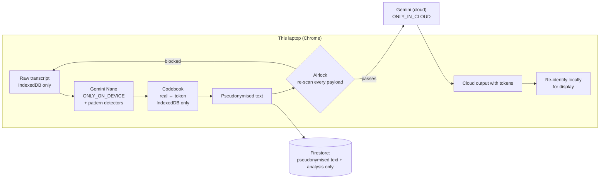

# Veil — pseudonymise on your device, analyse in the cloud

**Veil lets people use a cloud AI model on confidential documents — research interviews, HR investigation files, clinical letters, court judgments — while finding and removing the identities in them happens on their own laptop.**

Gemini Nano, running in Chrome through **Firebase AI Logic hybrid inference**, finds names, places, organisations, dates, contact details and rare identifying details *on the device*. Veil swaps each for a consistent placeholder (`[PERSON_1]`, `[ORG_4]`), shows the researcher exactly what will leave, re-scans every outgoing payload and blocks it if any known identifier slipped through (and flags name-like text nothing caught), and only then sends the pseudonymised text to cloud Gemini for long-context thematic analysis. The results come back with placeholders, and Veil puts the real names back — on the researcher's screen only.


Built for [#BuildHybridAI 2026](https://firebasehybridaihackathon.devpost.com/) · Web (Chrome) · Apache-2.0

---

## The problem

Interview research runs on consent forms and ethics approvals that promise participants their identities stay protected. Before a transcript can go anywhere near a third-party AI service, researchers typically have to pseudonymise it — by hand, line by line, for every interview. That is hours of work per transcript, it is error-prone, and it is the main reason many researchers can't use the AI tools everyone else uses.

The usual "local AI" answer doesn't solve it: a small on-device model can't do a good cross-interview thematic analysis of 60,000 characters of transcripts. The usual "cloud AI" answer can, but it means uploading identifiable data.

## How this differs from what researchers use today

| | Where identifiers are removed | AI analysis | Install |
|---|---|---|---|
| Dovetail, Condens, Marvin (research repositories) | Redaction runs **after upload**, in the vendor's cloud ([Dovetail](https://dovetail.com/changelog/automatic-redaction/), [Condens](https://condens.io/help/security-and-privacy/security-and-privacy-features/data-anonymization/), [Marvin](https://help.heymarvin.com/en/articles/10130399-how-do-i-mask-sensitive-and-personally-identifiable-information-pii-in-files)) | Yes, cloud | SaaS |
| ATLAS.ti / NVivo AI | Text is sent to a cloud model under no-training terms ([ATLAS.ti](https://atlasti.com/ai-data-security-and-privacy)) | Yes, cloud | Desktop |
| Microsoft Presidio, Private AI | Before sending — but you build/host the pipeline yourself ([Presidio](https://github.com/microsoft/presidio), [Private AI](https://docs.private-ai.com/what-is-privategpt)) | Bring your own | Python / container |
| **Veil** | **On the researcher's laptop, before anything is uploaded** (Gemini Nano + patterns + review + airlock) | Yes — cloud Gemini on pseudonymised text only | Open a web page |

Pseudonymised text is still personal data under GDPR — Veil reduces what reaches a cloud service and documents it for an ethics committee; it doesn't make data anonymous.

## The idea: split the trust, not just the workload

Most hybrid apps use the on-device model as a cheaper or offline *substitute* for the cloud. Veil uses the two models for **different jobs that need different levels of trust, at the same time, even with perfect connectivity**:

| Job | Sees | Firebase AI Logic mode | Why |
|---|---|---|---|
| Find identifiers in the raw transcript | identifiable text | `ONLY_ON_DEVICE` | Raw text must never leave. If Nano isn't available, Veil **fails closed** — it never falls back to the cloud with raw data. |
| Second check of the pseudonymised text (strict policy) | pseudonymised text | `ONLY_ON_DEVICE` | Catch what the first pass missed before release. |
| Read a photo of handwritten field notes | image of identifiable notes | `ONLY_ON_DEVICE` (text + image input) | Photos of notes are as sensitive as transcripts. |
| Thematic analysis of one interview | pseudonymised text | `ONLY_IN_CLOUD` | Needs a large model and long context. |
| Cross-interview synthesis | all pseudonymised transcripts (~60k chars) | `ONLY_IN_CLOUD` | Far beyond Nano's ~9k-token window. |
| Quick analytic memo | pseudonymised text | `PREFER_ON_DEVICE` | Free and offline when Nano is there; cloud fallback is safe because the input is already pseudonymised. |

Every call records `response.inferenceSource`, so the **Airlock log** shows, for each request, the mode Veil asked for, where inference actually ran, and the exact text that left the device.



## What it does

- **Pseudonymise on device.** Transcripts are chunked to fit Nano's prompt budget; Nano returns identifiers as structured JSON (Prompt API `responseConstraint`). Deterministic detectors catch fixed-shape identifiers (emails, UK and US phone numbers, postcodes and ZIP+4, street addresses, NHS-style numbers, SSNs and other reference numbers, specific dates). If Nano finds a first name, Veil also catches "First Surname".
- **Consistent placeholders across a study.** Organisations and places get the same token in every interview, so the cloud's cross-case analysis lines up. People are scoped per interview (two participants' "Gareth" are different people).
- **Review like a researcher.** Highlights in the raw text; click a highlight to keep that text; select any text to redact it by hand; a codebook table with on/off switches. Merge two placeholders that turn out to be the same person or place. Two policies: *Standard* keeps health details (often the research data itself) and *Strict* removes them too and adds a second on-device pass.
- **The airlock.** Right before *any* cloud request, Veil re-scans the payload against every codebook value and identifier pattern — including the interview title, which is user-written and often contains a name. One hit and the request is blocked, with a one-click "Redact these". The airlock only knows what was found, so a second, **model-independent** check flags name-like phrases still in the outgoing text that nothing caught ("Keith Holloway", "Northgate Home & Living") as *worth a look*, one click to redact. On our recorded Nano runs it surfaces 12 of the 18 names, organisations and places that Nano and the rules missed (interviews 4/7, TAB 6/6, record-style documents 2/5), at about 2–7 warnings per document. It never blocks; the human review step stays.
- **Cloud analysis, re-identified locally.** Reflexive thematic analysis (themes, verbatim quotes with timestamps, tensions, follow-up questions) per interview, plus a cross-interview synthesis. A switch flips between "real names (re-identified on this device)" and "exactly what the cloud saw".
- **Photos of handwritten notes, read on device.** Gemini Nano takes the image as input (`ONLY_ON_DEVICE`, image + text); the photo is shown next to the transcription for checking and never leaves the browser. On the bundled fictional field note (Chrome 158): read in about 14 s, 8 of 10 identifiers removed, airlock clean; Nano misread one letter of a place name ("Hollins" → "Collins") and still redacted it.
- **Encrypted backup.** Raw text and the codebook key live only in this browser, so *Encrypted backup of everything* writes the whole study encrypted with a passphrase (PBKDF2-SHA-256, 310k iterations → AES-256-GCM, Web Crypto) and *Restore a backup* brings it back on any machine. Nothing is uploaded.
- **Offline.** Pseudonymisation works with no connection. Cloud requests made offline are queued and sent when the connection returns; Firestore's offline cache syncs results.
- **Ethics audit pack.** One click exports (a) an audit report for an ethics committee with no identifiable data — policy, how each interview was checked, identifiers replaced per type, airlock blocks, and a SHA-256 of every payload that left the device; (b) a **REFI-QDA project (`.qdpx`)** — pseudonymised transcripts with every cloud-coded quote as a coded selection, validated against the official QDA-XML 1.0 schema — that NVivo, ATLAS.ti, MAXQDA and QDA Miner import, plus the pseudonymised dataset as Markdown and the coded quotes as CSV; (c) the codebook key, behind a warning, for secure storage.
- **Research questions.** A study's research questions steer the cloud analysis and synthesis — and go through the codebook and airlock, since they often name a site.
- **Quotes link back.** Click any quote in the cloud analysis to jump to that moment in the raw transcript.
- **Bring your own transcripts.** Paste text or upload `.txt`, `.vtt` (Zoom/Teams captions) or `.docx` — parsed in the browser, never uploaded. UK and US identifier formats are detected (phones, postcodes/ZIP+4, NHS/SSN-style numbers, street addresses).
- **Setup check.** A built-in panel tells you whether this browser can run Gemini Nano (Chrome version, Prompt API, text and image availability) and gives the exact `chrome://` flags to copy.
- **Measured, not claimed.** The bundled sample study (six entirely fictional interviews) ships with an answer key of every identifier, and Veil shows the share of identifiers removed for each interview, with the misses one click away.

### Measured on real Gemini Nano

Desktop Chrome 158, Gemini Nano via Firebase AI Logic (`ONLY_ON_DEVICE`), scored against answer keys of every identifier in fictional interviews. **Recall** = share of answer-key identifiers fully replaced; **precision** = share of replacements that are answer-key identifiers.

| Set | Build | Recall | Precision |
|---|---|---|---|
| **Held-out** — 4 interviews (US/UK/Ireland, UX/education/social care), never used for tuning | first look | 115 / 149 = **77.2%** | 96.8% |
| Held-out | after general fixes informed by those misses (titled names, $ amounts, ages, org acronyms) | 131 / 149 = **87.9%** | 97.1% |
| Development — 6 Long COVID interviews, used for tuning | first build | 214 / 265 = 80.8% | — |
| Development | current | 238 / 265 = **89.8%** | 90.2% |
| Development, Strict policy (also health terms, second on-device pass) | | 276 / 338 = 81.7% | — |

**Baseline — Microsoft Presidio** (open-source PII detector, spaCy `en_core_web_lg`, scored with the same code on the same interviews; reproduce with [`eval/`](eval/README.md)):

| Held-out set | Recall | Precision |
|---|---|---|
| Presidio, default recognisers | 60.4% | 53.4% |
| Presidio, organisations + money switched on | 81.2% | 66.7% |
| **Veil** (Gemini Nano on device), first look | 77.2% | **96.8%** |
| **Veil**, current | **87.9%** | **97.1%** |

**Public benchmark — TAB** ([Text Anonymization Benchmark](https://github.com/NorskRegnesentral/text-anonymization-benchmark), MIT): short European Court of Human Rights judgments with expert annotations of direct and quasi identifiers — real public court texts, a different domain from interviews. We tuned only on TAB's **dev** split and ran the **test** documents once at the end.

| TAB set | Docs (labels) | Veil recall / precision | Presidio default | Presidio orgs on |
|---|---|---|---|---|
| **Test A** — the 8 shortest test judgments, first look before any TAB work | 8 (132) | 65.2% / 69.2% | 75.0% / 73.4% | 78.8% / 57.7% |
| Test A, current Veil (not blind: these misses informed the generic detectors) | 8 (132) | 89.4% / 77.4% | same | same |
| **Dev** — 12 shortest dev judgments, before tuning | 12 (226) | 77.0% / 81.6% | 68.6% / 75.3% | 74.8% / 56.0% |
| Dev, after tuning (birth years, counties/regions gazetteer, marital status, case numbers, nationality, household) | 12 (226) | 88.5% / 79.7% | same | same |
| **Test B** — test judgments ranked 9–16 by length, unseen, run once | 8 (195) | **87.2% / 82.4%** | 60.5% / 78.4% | 64.6% / 58.2% |

**Why Presidio is 75–79% on one test set and 60–65% on the other:** they are different documents, not a different scorer. Test A is the eight shortest test judgments; in Test B, the next eight, a quarter of the labels are case and application numbers (45 of 195, vs 8 of 132 in Test A) plus 8 money amounts. Presidio finds people and dates almost perfectly on both sets but catches 2 of those 45 numbers and none of the amounts, so its recall drops; with those two types left out it scores 84% on Test A and 87% on Test B. Midway through we found a bug in our scorer (it checked answer-key text as substrings, so "Vance" was "missed" inside "grievance") and fixed it to match whole words. We then re-scored **every** Presidio and Veil result we have spans or a recording for with both versions:

| Set | Presidio default, old → new scorer | Presidio orgs on, old → new | Veil, old → new |
|---|---|---|---|
| TAB test A | 75.0 → 75.0 | 78.8 → 78.8 | live run, new scorer only |
| TAB dev | 68.6 → 68.6 | 74.8 → 74.8 | 88.5 → 88.5 |
| TAB test B | 60.5 → 60.5 | 64.6 → 64.6 | 87.2 (live run, old scorer; no recording to re-score) |
| Held-out interviews | 60.4 → 61.1 | 81.2 → 81.9 | live runs, old scorer |
| Development interviews | — | 72.8 → 72.8 | 89.8 → 89.8 |
| HR file + discharge summary + court judgment | — | 74.7 → 75.8 | 84.2 → 85.3 |

Recall in %, precision unchanged in every row. The fix never moved a TAB number; where it moved anything, it raised Presidio and Veil alike. Both baselines always use the same `evaluate()`, the same answer keys and the same policy types as Veil.

**What does Gemini Nano add over the rules?** Same recorded Nano runs, replayed with and without Nano's detections (`planning/tab/offline.ts`):

| Set | Rules only (patterns, gazetteer, field names) | Rules + Gemini Nano |
|---|---|---|
| Interviews (6, conversational) | 55.1% recall / 97.1% precision | **89.8% / 97.3%** |
| TAB dev (12 court judgments) | 75.7% / 81.2% | **88.5% / 79.7%** |
| HR file + discharge summary + court judgment | 77.9% / 91.9% | **85.3% / 89.4%** |

In conversation — where names, schools and places come with no fixed shape — Nano supplies most of the recall. In form-like documents the rules carry more (they were also tuned on these two sets, so their share there is flattering). The rules never replace the model; they catch the fixed-shape things a small model drops.

**Beyond interviews — court judgment, HR file, clinical letters** (load them from the sidebar: *3 more scenarios*). The same pipeline on record-style documents, real Gemini Nano in Chrome 158, Standard policy. The three documents in the app were used to fix what they exposed (multi-part reference codes like `HR-INV-2024-089`, letterheads in capitals, names listed in record fields such as "Present:"); two further documents were generated afterwards and run once (`?load=scenarios-unseen`).

| Documents | Labels | Veil recall | Veil precision | Presidio default | Presidio orgs on |
|---|---|---|---|---|---|
| Court judgment (TAB) + HR investigation file + discharge summary, first look | 95 | 74 / 95 = 77.9% | 88.9% | 65.3% / 81.9% | 75.8% / 79.7% |
| Same three, after the fixes | 95 | 84 / 95 = **88.4%** | 91% | | |
| **Unseen: HR disciplinary file + respiratory clinic letter, run once** | 75 | 64 / 75 = **85.3%** | **92%** | 50.7% / 79.0% | 70.7% / 79.2% |

The airlock found no known identifier in the outgoing text of any of the five. What's left is mostly job titles ("Senior HR Adviser"), bare years and small details ("border collie") — quasi-identifiers a reviewer still has to judge.

A well-configured Presidio finds about as many identifiers as Veil did at first look, but a third of what it redacts isn't an identifier — that's review work and lost research data — and it misses most quasi-identifiers (4 of 13). Presidio also needs a Python server; Veil runs in the browser with nothing to install.

The six-interview study pseudonymises in about 4–5 minutes on a MacBook, entirely on device; the airlock found no known identifier in any outgoing payload in any run. What Nano still misses is mostly quasi-identifiers — a rare hobby, an unusual job description, a small place name — which is why Veil keeps the human review step and shows every miss. Nano is not deterministic: a few items caught in one run are missed in the next.

**No Gemini Nano in your browser?** Click **Replay a recorded Nano run**: the sample study loads with the detections real Gemini Nano made in Chrome 158 (clearly labelled as recorded), and review, the airlock and cloud analysis run live.

| Cloud analysis, re-identified on this device | Exactly what the cloud saw |
|---|---|
|  |  |

## Data handling, honestly

- Raw text, photos and the re-identification key stay in this browser (IndexedDB). The cloud receives pseudonymised text only, after the airlock.
- This is **pseudonymisation, not anonymisation**: on unseen documents Veil still misses roughly one identifier in seven or eight, mostly quasi-identifiers such as job titles. Review is part of the workflow for that reason.
- The hosted demo uses the no-billing Gemini Developer API, whose terms let Google use prompts on unpaid tiers to improve its products. That is acceptable here only because those prompts are pseudonymised. For a real study, use a paid Gemini API key or Firebase AI Logic's Vertex AI backend (`new VertexAIBackend()` instead of `new GoogleAIBackend()` in `src/ai/backend.ts`).

## Firebase products used

| Product | How Veil uses it | Code |
|---|---|---|
| **Firebase AI Logic** (hybrid inference, Gemini Developer API backend) | Six model instances across `ONLY_ON_DEVICE`, `ONLY_IN_CLOUD`, `PREFER_ON_DEVICE`; `initializeDeviceModel` with download progress; structured output on device (`responseConstraint`) and in cloud (`responseSchema`); streaming; `inferenceSource` | [`src/ai/backend.ts`](src/ai/backend.ts) |
| **App Check** | Required by AI Logic; reCAPTCHA Enterprise in production, debug provider in development | [`src/firebase.ts`](src/firebase.ts) |
| **Authentication** | Anonymous sign-in, so each researcher's Firestore data is private to them | [`src/firebase.ts`](src/firebase.ts) |
| **Cloud Firestore** | Stores only pseudonymised text and analysis; offline persistence. Security rules also reject interview text containing an email, a UK mobile, a US SSN or a US phone number — a last-ditch backstop against bad writes, not the privacy mechanism (the airlock runs before anything is sent) | [`src/store/cloud.ts`](src/store/cloud.ts), [`firestore.rules`](firestore.rules) |
| **Remote Config** | Cloud model name, default redaction policy, on-device chunk size — changeable without a redeploy | [`src/firebase.ts`](src/firebase.ts), [`remoteconfig.template.json`](remoteconfig.template.json) |
| **Hosting** | Serves the app | [`firebase.json`](firebase.json) |

What never touches Firebase or any server: raw transcripts, photos of notes, and the codebook (all in IndexedDB, [`src/store/local.ts`](src/store/local.ts)).

## Try it

**No Gemini Nano? 60 seconds:** [?load=replay](https://veil-hybrid-29fb6.web.app/?load=replay) (sample interviews) or [?load=replay-scenarios](https://veil-hybrid-29fb6.web.app/?load=replay-scenarios) (HR file, hospital letter, court judgment, handwritten note read from a photo) — detections recorded from real Gemini Nano in Chrome 158, clearly labelled; the airlock, cloud analysis and exports run live.

**With Gemini Nano:** [?load=quick](https://veil-hybrid-29fb6.web.app/?load=quick) pseudonymises one page live in about 13 seconds. For the full study:

**Hosted:** https://veil-hybrid-29fb6.web.app — desktop Chrome 139+ with Gemini Nano for the live on-device path. **No Nano?** The first button on the page loads the sample study with a recorded real Gemini Nano run; everything else runs live.

1. Enable `chrome://flags/#prompt-api-for-gemini-nano-multimodal-input`, restart Chrome.
2. Open Veil and click **Set up on-device model** (one-time download, stays on your machine).
3. Click **Load the sample study** → open an interview → **Pseudonymise on this device**.
4. Review the highlights, check the airlock, then **Release to cloud analysis**.
5. Open **Cross-interview synthesis**, and the **Airlock log** to see where every call ran and what left the device.
6. Click **Test the airlock**: Veil slips a real name back into the outgoing text and shows the airlock blocking it (nothing is sent).
7. To see it fail closed, open Veil in a browser without Gemini Nano: pseudonymisation falls back to pattern detection + manual redaction, never to the cloud, and release stays locked until you confirm a manual review.

If the chip says "On-device model unavailable" in Chrome 139+: check `chrome://on-device-internals` for the model status, make sure the flag above is enabled, and on some machines also set `chrome://flags/#optimization-guide-on-device-model` to *Enabled BypassPerfRequirement*. Veil's **check setup** panel walks through each requirement. Chrome only downloads Gemini Nano when the profile drive has at least 22 GB free (the model itself is much smaller) and the machine has a supported GPU or enough RAM — see Chrome's Prompt API docs.

The sample and held-out interviews in [`sample-data/`](sample-data) are entirely fictional, generated for testing; phone numbers use Ofcom's drama range and emails use `example.com`. `sample-data/tab/` holds 8 real, public ECHR judgments from the Text Anonymization Benchmark (MIT licence) with its expert annotations.

## Run locally

```bash
npm install
cp .env.example .env   # fill in your Firebase web app config
npm run dev            # http://localhost:5180
npm test               # unit tests: pseudonymisation, airlock, chunking, evaluation, exports, .docx
```

Firebase setup:

1. Create a Firebase project → **AI Services → AI Logic → Get started** → choose the **Gemini Developer API** (no billing needed). This also enforces App Check for AI Logic.
2. Add a **Web app**, copy its config into `.env`.
3. **Authentication** → enable **Anonymous**. **Firestore** → create a database. 
4. **App Check** → enable the reCAPTCHA Enterprise API, create a web key for your Hosting domains, and register the web app with the **reCAPTCHA Enterprise** provider (put the site key in `VITE_RECAPTCHA_SITE_KEY`). For localhost, run `npm run dev`, copy the debug token printed in the console and add it under App Check → Manage debug tokens. Never commit it.
5. `npx firebase-tools deploy --only firestore:rules,remoteconfig,hosting` (after `npm run build`).

## Honest limits

- On-device inference needs desktop Chrome 139+ with the Prompt API; Nano's quality is lower than a cloud model's, which is why Veil adds deterministic detectors, a second pass, a human review step and the airlock rather than trusting one model.
- Pseudonymisation is not anonymisation: rich qualitative data can be re-identifiable from context. Veil reduces the work and the risk; the researcher still reviews and stays responsible to their ethics approval.
- The airlock checks for identifiers Veil knows about (codebook + patterns). It cannot catch an identifier no detector and no reviewer ever flagged — which is why the human review step exists and why Veil reports how many identifiers it removed on the answer-keyed sample.
- `deviceStatus()` reads Chrome's `LanguageModel.availability()` directly, only to show model status in the header before any click; every inference call goes through Firebase AI Logic. If the SDK doesn't report `inferenceSource`, the log says "source not reported" rather than guessing.

## Built during #BuildHybridAI

Everything in this repository was written during the submission period (work started 2026-11-21; the period opened 2026-11-11). The team builds [aicoo](https://www.aicoo.io), an AI workspace with meeting recording and transcription; Veil is a new, separate, open-source app and contains no aicoo code. Development used Claude Code as the coding assistant. Third-party code: React, Vite, the Firebase JS SDK (all via npm, under their own licences).

## Licence

[Apache-2.0](LICENSE)
